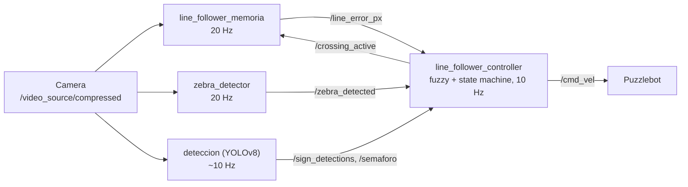
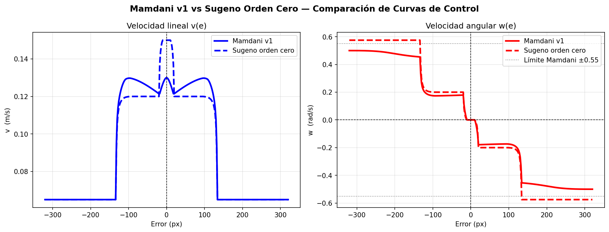
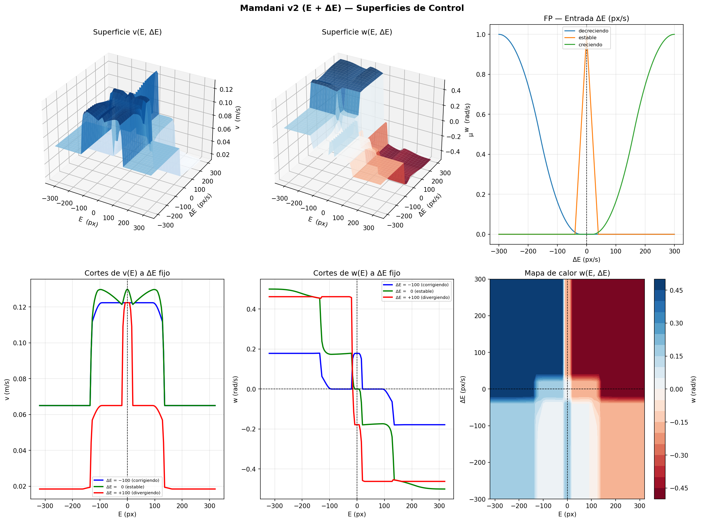

# Puzzlebot Autonomous Line Follower

ROS 2 package that drives a Puzzlebot (Jetson based differential drive robot) around a small road circuit: it follows the lane, obeys traffic lights and signs, and crosses intersections at zebra crossings. Line following is handled by a Mamdani fuzzy controller inside a 7 state finite state machine.

Team project for the Robotics Implementation course at Tecnológico de Monterrey (2026), by Roberd Meza Sainz and Emiliano Moreno Gómez.

## Architecture

Perception and control run as four independent nodes, so the YOLO inference time never blocks the 20 Hz line detection loop.



| Node | What it does |
|---|---|
| `line_follower_memoria` | CLAHE contrast normalization and adaptive thresholding on two horizontal bands: an anchor band near the robot and a lookahead band further ahead. An anchor memory rejects sudden jumps so the robot does not switch lanes in tight curves. Paused during crossings. |
| `zebra_detector` | Finds stripe candidates by area and aspect ratio, then validates the group geometrically: at least 3 stripes, roughly collinear centroids and regular spacing. Debounced (3 frames on, 5 off) to avoid false positives. |
| `deteccion` | YOLOv8 at 320 px input detecting direction arrows (left, right, straight), stop, give way, roadwork ahead and red / yellow / green traffic lights. |
| `line_follower_controller` | Fuzzy line following plus the state machine that reacts to lights, signs and zebra crossings, including open loop turning maneuvers. |

## Fuzzy controller

One input, the lateral line error in pixels, and two outputs, linear and angular velocity:

* **Input:** 5 membership functions (large / small negative error, no error, small / large positive error), with Z and S shaped functions at the extremes.
* **Rules:** small errors keep normal speed and steer gently; large errors slow the robot down and steer hard; no error drives straight at full speed.
* **Result:** about 0.13 m/s on a straight line, dropping to 0.065 m/s in sharp curves, with the turn rate saturating at ±0.5 rad/s.

It replaced an earlier PD controller, encoding the nonlinear relation between error and steering directly in linguistic rules.

### Controller analysis

The `analysis/` folder compares the deployed Mamdani controller against a zero order Sugeno equivalent with the same membership functions:



It also contains a design study for a second input, the error derivative ΔE (3 membership functions, 15 rules), which lets the controller steer harder when the error is growing and ease off when it is already shrinking:



## State machine

```
FOLLOW_LINE → SIGN_LATCHED → STOP_PRE → CROSSING → STOP_POST → RECOVERING → SIGN_LATCHED
                    └──────→ STOP_SIGN
```

The last arrow seen is latched and decides the maneuver at the next zebra crossing (turn left, turn right or go straight). A red light latches a stop that only a green or yellow light releases. Line detection is paused while crossing and the robot only returns to line following once the line is re acquired stably.

## Running

```bash
pip install scikit-fuzzy ultralytics
cd ~/ros2_ws && colcon build --packages-select puzzlebot_line_follower && source install/setup.bash

ros2 run puzzlebot_line_follower line_follower_memoria
ros2 run puzzlebot_line_follower zebra_detector
ros2 run puzzlebot_line_follower deteccion --ros-args -p yolo_model_path:=/path/to/weights.pt
ros2 run puzzlebot_line_follower line_follower_controller
```

The YOLO weights are not included in the repository. The standalone controllers from the Mamdani vs Sugeno comparison run with `ros2 run puzzlebot_line_follower mamdani_v1` and `sugeno_v1`, and the curves are regenerated with `cd analysis && python3 curve_analysis.py`.

## Repository layout

```
puzzlebot_line_follower/   ROS 2 nodes
analysis/                  Fuzzy controller curves, surfaces and the script that generates them
prototypes/                Early HSV based line and traffic light detectors, superseded by the nodes above
```
